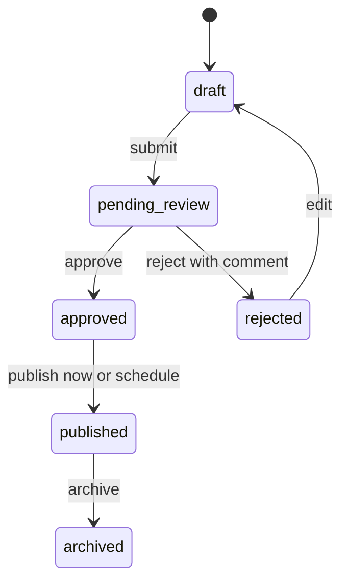

# News CMS

News CMS is a small newsroom/blog application. Writers create drafts, editors review them, administrators manage users and categories, and super admins can inspect the append-only audit trail. The server is the authority for every permission check; the browser navigation is only a convenience.

## Why this shape?

The code uses plain CommonJS JavaScript, Express, and parameterized MySQL queries. The service layer keeps business rules out of route handlers so a junior developer can follow one request from the router to the database transaction.

## Features

- Cookie-based JWT authentication with a database lookup on every request.
- Four roles: `writer`, `editor`, `admin`, and `super_admin`.
- Draft, review, approval, publication, archive, rejection, soft-delete, and restore workflow.
- Race-safe workflow transitions and revision history.
- UTC storage and ISO 8601 API dates.
- Public published-blog API and responsive plain HTML/CSS/JS pages.
- Temporary passwords for administrator-created users, shown once.
- Append-only audit logging and category/tag management.
- Helmet CSP, parameterized SQL, validation, and rate limits.

## Permission matrix

| Action                         | Writer | Editor       | Admin        | Super admin |
| ------------------------------ | ------ | ------------ | ------------ | ----------- |
| Create draft                   | Yes    | Yes          | Yes          | Yes         |
| Edit own draft/rejected post   | Yes    | Yes          | Yes          | Yes         |
| Edit another non-archived post | No     | Yes          | Yes          | Yes         |
| Submit own post                | Yes    | Yes          | Yes          | Yes         |
| Approve/reject                 | No     | Yes, not own | Yes, not own | Yes         |
| Publish/archive                | No     | Yes          | Yes          | Yes         |
| Delete own draft               | Yes    | Yes          | Yes          | Yes         |
| Delete/restore any post        | No     | No           | Yes          | Yes         |
| Manage categories              | No     | No           | Yes          | Yes         |
| Manage writers/editors         | No     | No           | Yes          | Yes         |
| Manage admin roles             | No     | No           | No           | Yes         |
| View audit log                 | No     | No           | No           | Yes         |

## Workflow



## Stack

Node.js 20+, Express, mysql2/promise, Joi, bcrypt, jsonwebtoken, cookie-parser, helmet, express-rate-limit, morgan, node:test, supertest, ESLint, and Prettier. There is no ORM, TypeScript, frontend framework, multer, cron, or mailer.

Versions used for the database-backed test run: Node.js v24.17.0 and MySQL 8.0.46.

## Setup

Copy `.env.example` to `.env` only when you do not already have a configured `.env`. `npm run setup-db` creates `news_cms` and `news_cms_test`, applies the schema, and seeds categories. The setup command is restricted to those names; the application test runner connects only to `DB_NAME_TEST`, which must end in `_test`.

PowerShell:

```powershell
if (!(Test-Path .env)) { Copy-Item .env.example .env }
npm install
npm run setup-db
npm run create-super-admin
npm start
```

Bash:

```bash
[ -f .env ] || cp .env.example .env
npm install
npm run setup-db
npm run create-super-admin
npm start
```

To rebuild both project databases from a clean slate, run `npm run setup-db -- --reset`. This drops and recreates only `news_cms` and `news_cms_test`.

For a disposable demo, `npm run seed-demo` creates one user per role and prints each random temporary password once. Do not put those credentials in source control.

## Environment variables

`NODE_ENV`, `PORT`, `DB_HOST`, `DB_PORT`, `DB_USER`, `DB_PASSWORD`, `DB_NAME`, `DB_NAME_TEST`, `JWT_SECRET` (at least 32 characters), `COOKIE_SECURE`, and optional production `DB_CA_CERT` are supported. In production, use `COOKIE_SECURE=true` and a verified database TLS certificate.

Login failures are throttled after five attempts for a normalized email within 15 minutes. This account counter is in-memory and single-instance; it is not shared across multiple app processes. The existing per-IP login limit remains in place.

## API

| Method              | Endpoint                                                 | Purpose                                   |
| ------------------- | -------------------------------------------------------- | ----------------------------------------- |
| POST                | `/api/auth/login`                                        | Log in and receive an httpOnly cookie     |
| POST                | `/api/auth/logout`                                       | Clear the cookie                          |
| GET                 | `/api/auth/me`                                           | Load the current database-backed user     |
| POST                | `/api/auth/change-password`                              | Replace a current or temporary password   |
| GET                 | `/api/posts/public`                                      | Search published posts                    |
| GET                 | `/api/posts/public/:slug`                                | Read a published post and increment views |
| GET/POST            | `/api/posts`                                             | List or create posts                      |
| GET/PUT             | `/api/posts/:id`                                         | Read or edit a post                       |
| PATCH               | `/api/posts/:id/{submit,approve,reject,publish,archive}` | Change workflow state                     |
| DELETE/POST         | `/api/posts/:id` and `/restore`                          | Soft-delete or restore                    |
| GET/POST            | `/api/posts/:id/revisions`                               | List or restore revisions                 |
| GET/POST/PUT/DELETE | `/api/categories`                                        | Public list and admin changes             |
| GET/POST/PATCH      | `/api/users`                                             | Admin user management                     |
| GET                 | `/api/audit-logs`                                        | Super-admin audit search                  |

Successful responses are `{ data }` or `{ data, pagination }`. Failures are `{ error: { message, fields?, code? } }`.

## Folder tree

```text
src/
  config/       environment and MySQL pool
  middleware/   auth, validation, rate limits, errors
  routes/       HTTP endpoints
  services/     business rules and transactions
  utils/        shared response, role, audit, slug helpers
  app.js        Express composition
  server.js     process entry point
public/         framework-free pages, CSS, and browser code
sql/            schema and category seed
scripts/        setup and demo-user commands
tests/          unit and smoke tests
notes/          private, gitignored interview material
```

## Checks

```bash
npm test
npm run lint
npm run format
```
